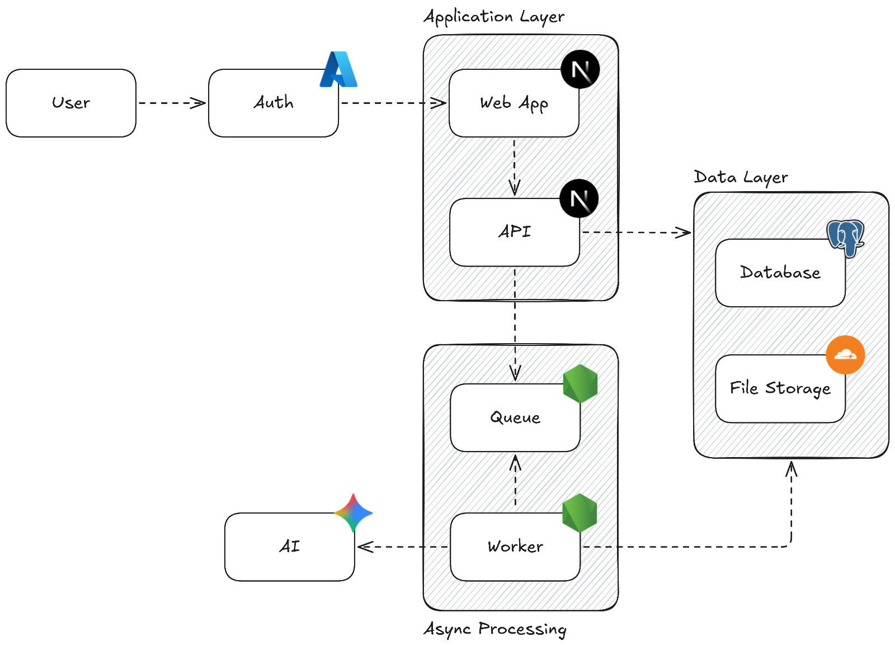

# USP ATS

An AI-assisted Applicant Tracking System for USP job postings. Admins post and manage jobs, students build a profile and apply, and an AI scoring feature assists admins in evaluating applicants.

## Features

### Members

- Sign in with Entra ID (SSO)
- Onboarding flow to build a profile (degrees, education, skills, GPA, projects)
- Browse a searchable, filterable job feed (campus, GPA requirement, job type)
- Apply to jobs with a profile snapshot and cover letter
- Track application status (applied, shortlisted, accepted, declined, withdrawn)
- Withdraw applications

### Admins

- Full CRUD on job postings with approval gating (a second admin must approve; self-approval is blocked)
- Archive (soft-delete) postings; withdraw pending approvals
- View all applications for a posting, ranked by AI score
- Update application statuses
- View AI scoring results: match score, eligibility, qualification and motivation fit, missing requirements

## Tech Stack

| Layer | Choice |
| --- | --- |
| Framework | Next.js (App Router) |
| UI | HeroUI + Tailwind CSS v4 |
| ORM | Prisma |
| Database | Neon (Postgres) |
| Auth | better-auth + Entra ID (Microsoft/Azure AD) |
| Forms and validation | React Hook Form + Zod |
| Data fetching | TanStack Query |
| Async processing | trigger.dev |
| AI scoring | Gemini API via Vercel AI SDK |
| File storage | Cloudflare R2 |
| Hosting | Vercel |

## Architecture

Users authenticate through Entra ID SSO and land on the Next.js application layer. The web app serves UI, and its API routes persist data to Postgres (Neon) via Prisma and files to Cloudflare R2. Application submissions enqueue an async job through trigger.dev; a worker runs AI scoring with the Gemini API and stores results, which admins see in the applications table.



## Project Setup

### Prerequisites

- Node.js
- pnpm

### Getting started

```sh
pnpm install
cp .env.example .env  
pnpm prisma db push
pnpm db:seed           
pnpm dev
```

### Environment variables

Copy `.env.example` to `.env` and set:

| Variable | Purpose |
| --- | --- |
| `DATABASE_URL` | Neon Postgres connection string used by Prisma |
| `BETTER_AUTH_SECRET` | Secret for better-auth session signing |
| `BETTER_AUTH_URL` | Base URL of the app |
| `MICROSOFT_CLIENT_ID` | Entra ID app (client) ID |
| `MICROSOFT_CLIENT_SECRET` | Entra ID client secret |
| `MICROSOFT_TENANT_ID` | Entra ID tenant ID |
| `R2_ACCOUNT_ID` | Cloudflare R2 account ID |
| `R2_ACCESS_KEY_ID` | Cloudflare R2 access key |
| `R2_SECRET_ACCESS_KEY` | Cloudflare R2 secret key |
| `R2_BUCKET_NAME` | R2 bucket name |
| `R2_PUBLIC_URL` | Public base URL of the R2 bucket |
| `TRIGGER_SECRET_KEY` | trigger.dev API key |
| `GOOGLE_GENERATIVE_AI_API_KEY` | Gemini API key for AI scoring |

### Scripts

| Command | Purpose |
| --- | --- |
| `pnpm dev` | Run the dev server |
| `pnpm build` | Production build |
| `pnpm lint` | Lint with ESLint |
| `pnpm typecheck` | Type-check with tsc |
| `pnpm test` | Run Vitest tests |
| `pnpm prisma db push` | Sync the Prisma schema to the database |

## Deployment

The app deploys to Vercel. Only the Next.js application is internet-facing; the database, queue, and AI processing are not directly exposed.

## Authors

| Name | ID | Role |
| --- | --- | --- |
| Anav Chand | S11221203 | Architect & Cloud Engineer |
| Vishant Kumar | S11230430 | Full-stack Developer |
| James Kado | S11200776 | Full-stack Developer |
| Rohan Nandan | S11234883 | AI/ML Engineer & QA Engineer |
| Dipika Narayan | S11231549 | Full-stack Developer & QA Engineer |
